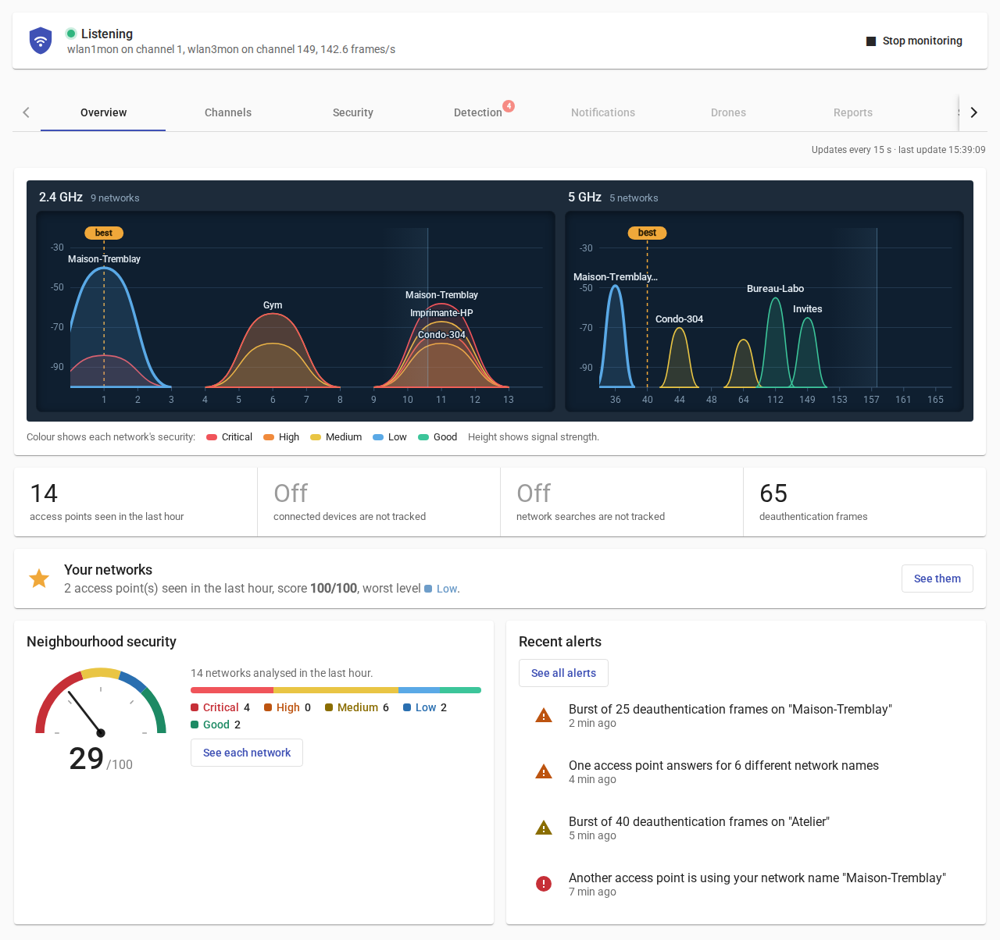
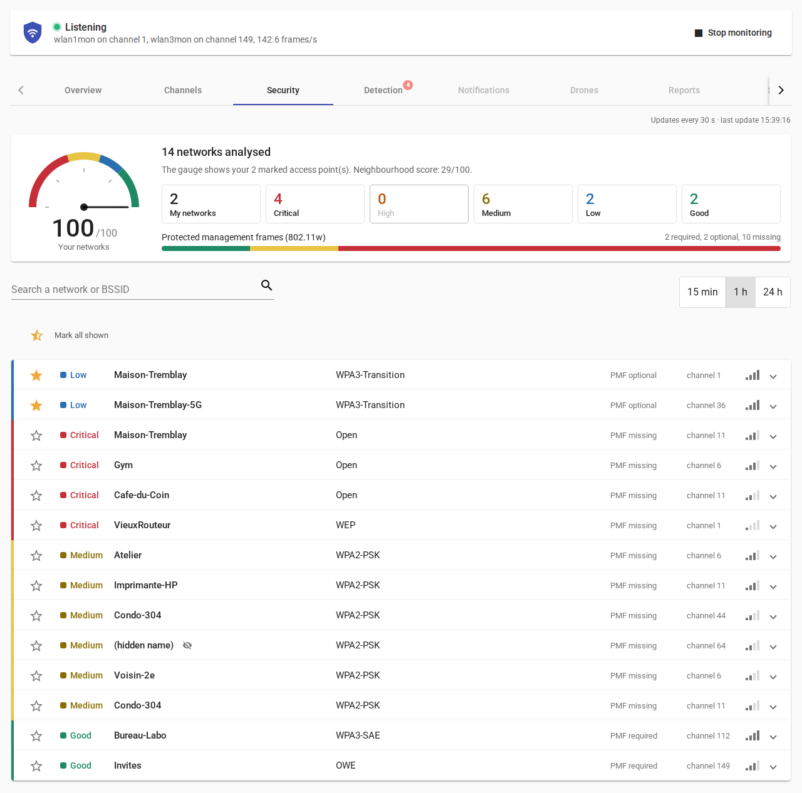
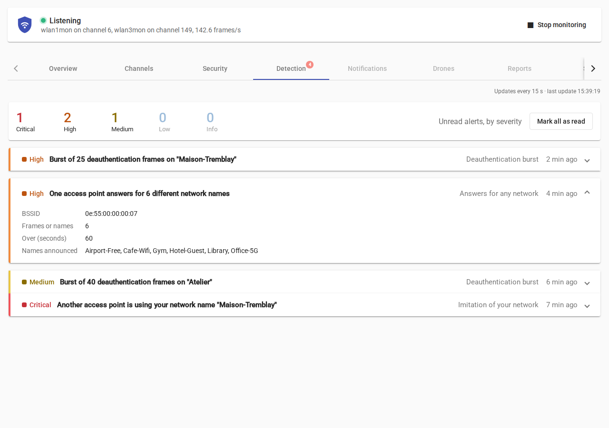

# Sentinel

**Donnez une deuxième vie à votre WiFi Pineapple qui dort dans un tiroir : un gardien discret qui vérifie la sécurité de votre Wi-Fi.**

[English version](README.md)



## Pourquoi Sentinel ?

Beaucoup de WiFi Pineapple passent leurs journées dans un tiroir. Le test d'intrusion est fini, la formation est
terminée, ou quelqu'un l'a essayé une fois et n'en a plus eu besoin. Ça reste pourtant une excellente radio Wi-Fi.

Sentinel transforme ce Pineapple en **sentinelle passive de votre propre Wi-Fi**. Branchez-le, ouvrez le module, et il vous dit :

- **à quel point vos réseaux sont sécurisés**, avec des explications claires (WPA3, PMF, réseaux ouverts, WPS…) ;
- **qui d'autre émet autour de vous**, et quel canal est le plus calme ;
- **quand quelque chose ressemble à une attaque** : quelqu'un qui copie le nom de votre réseau, une rafale de trames
  qui déconnectent vos appareils, une avalanche de faux points d'accès.

Sentinel **ne fait qu'écouter**. Il n'émet jamais aucune trame, n'attaque rien et, par défaut, n'enregistre rien
sur les appareils des autres.

## Ce qu'il vous faut

- Un **WiFi Pineapple Mark VII** (firmware 2.1.3).
- En option, mais recommandé : l'**adaptateur MK7AC**, pour surveiller aussi la bande 5 GHz (canaux DFS compris).
- Un ordinateur relié au Pineapple (USB ou son Wi-Fi d'administration). **Le Pineapple n'a jamais besoin d'Internet.**

## Installation en deux minutes

1. Téléchargez tous les fichiers de la [dernière version](../../releases/latest) dans un même dossier.
2. Depuis ce dossier, sur votre ordinateur :
   ```sh
   sha256sum -c SHA256SUMS          # macOS : shasum -a 256 -c SHA256SUMS
   sh install-from-pc.sh --reboot   # demande le mot de passe root du Pineapple
   ```
3. Quand le Pineapple est revenu (environ deux minutes), rechargez son interface web avec **Ctrl+Maj+R** et ouvrez **Sentinel**.

Le script vérifie chaque fichier, installe le module et sa seule dépendance (`python3-sqlite3`, le paquet exact
testé sur un Mark VII), et garde vos réglages et vos données lors des mises à jour. Les autres façons d'installer
sont dans la [version anglaise](README.md#install-in-two-minutes).

## Premier démarrage

1. **Settings** : la Radio 1 est `wlan1mon` (2,4 GHz). Activez la Radio 2, choisissez le MK7AC (`wlan3`) et
   **5 GHz, all channels**. Enregistrez, puis appuyez sur **Start monitoring**.
2. **Marquez vos propres réseaux.** Dans **Security**, tapez le nom de votre réseau dans la recherche, puis cliquez sur
   l'étoile en haut de la liste : toutes les bornes de ce réseau deviennent les vôtres. Sentinel propose aussi les
   autres réseaux de la même borne. Vous obtenez un score pour **vos** réseaux, et Sentinel sait quoi protéger.

   

3. **Laissez-le écouter.** Les alertes apparaissent dans **Detection**, avec une pastille sur l'onglet.

## Ce qu'il détecte

| Alerte | Quand |
|---|---|
| Imitation de votre réseau | une autre borne annonce le nom de votre réseau (critique si sa sécurité est plus faible) |
| Deux appareils, une adresse | l'adresse de votre borne annonce deux sécurités ou deux empreintes en même temps |
| Sécurité affaiblie | votre borne est soudain annoncée avec une sécurité plus faible, ou sans PMF obligatoire |
| Borne modifiée | l'empreinte de votre borne a changé (souvent une mise à jour : acceptez-la en un clic) |
| Changement de canal | votre borne reste sur un autre canal |
| Rafale de désauthentifications | 10 trames en 5 s, ou 30 en une minute, sur une borne |
| Faux points d'accès | des dizaines de bornes jamais vues d'un coup (gardées hors de la base) |
| Répond à tous les noms | une borne annonce 5 noms différents en une minute |



**Limites, en toute honnêteté :** avec deux radios qui sautent d'un canal à l'autre, chaque canal n'est écouté
qu'une partie du temps, donc une attaque très courte peut passer inaperçue. Sentinel vous prévient ; il ne bloque
et ne répond jamais à rien.

## Bon à savoir

- **Vie privée par défaut :** aucune adresse d'appareil (MAC) ni aucun nom de réseau recherché n'est enregistré, sauf si
  vous activez le suivi.
- **Léger :** environ 40 % de l'unique cœur du Pineapple avec les deux radios, environ 12 Mo de mémoire, base limitée à 64 Mo.
- Pendant l'écoute, Sentinel coupe le `wlan3` inutilisé pour que la radio 5 GHz puisse changer de canal. « Stop monitoring »,
  un redémarrage ou `uninstall.sh` le rendent.
- Ne lancez pas Recon sur la même radio en même temps. Pour utiliser le Pineapple à autre chose, arrêtez simplement l'écoute.
- Les canaux 120 à 128 sont refusés au Canada (radars météo) : c'est normal.

## Désinstallation

```sh
sh /pineapple/modules/Sentinel/uninstall.sh            # garde vos données et python3-sqlite3
sh /pineapple/modules/Sentinel/uninstall.sh --purge    # efface aussi /root/.Sentinel
```

Licence MIT, par Not_Hackerman. Écrit avec l'aide des assistants IA Claude et Fable.
*Les captures d'écran viennent de la démo, avec des réseaux fictifs.*
