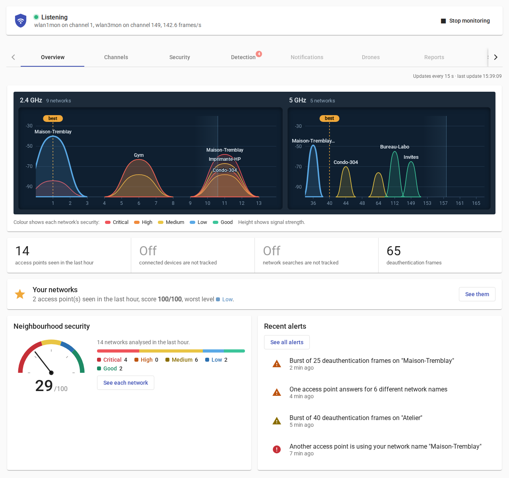
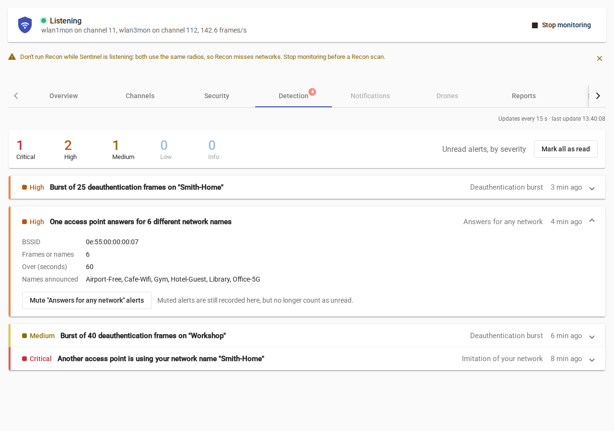
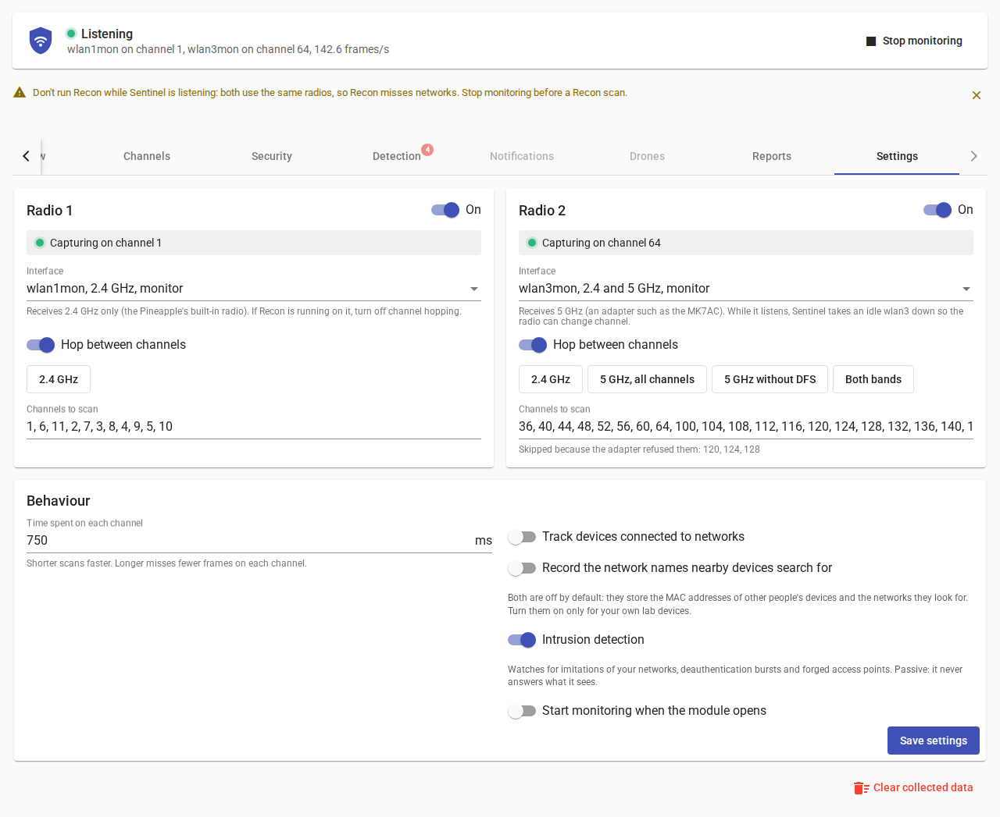
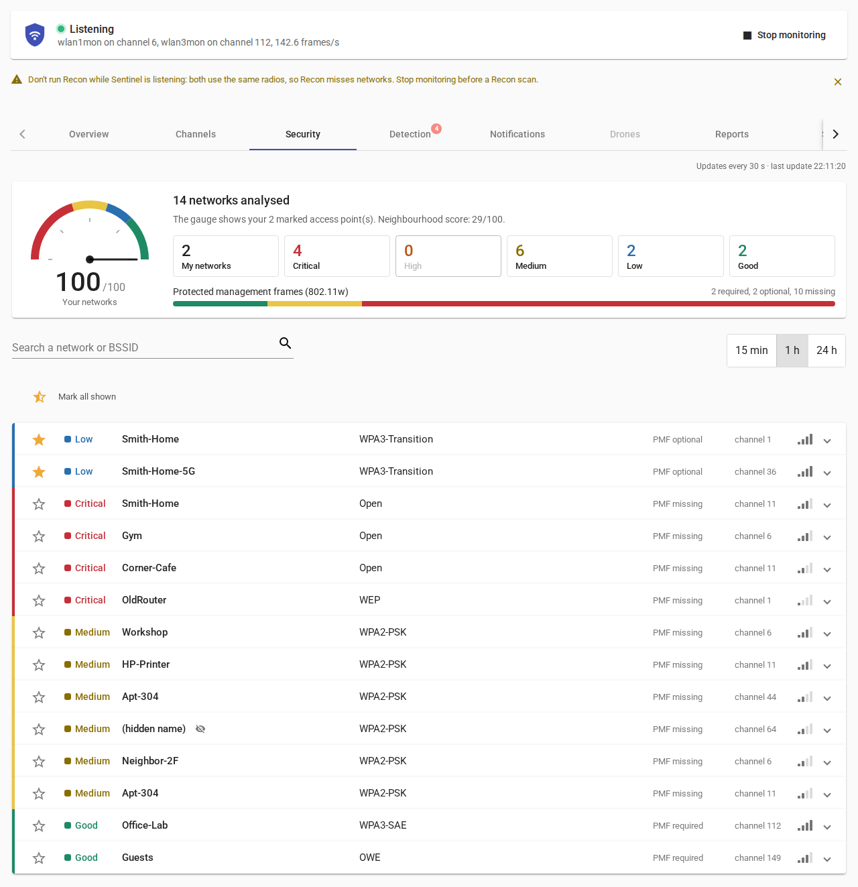
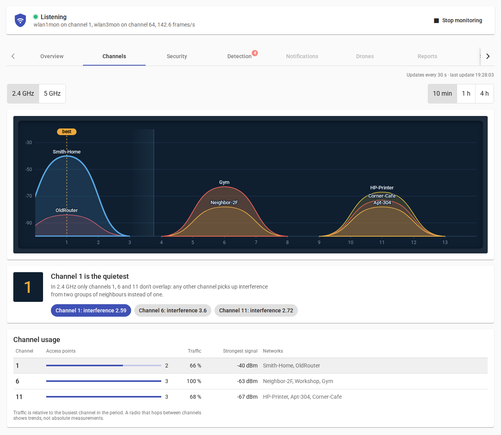

# Sentinel

A module for the WiFi Pineapple Mark VII that watches your own Wi-Fi instead of attacking someone else's.

[Version française](README.fr.md)



I had a Pineapple sitting in a drawer. Once your tests are done, there isn't much left to do with it, and I figured a
lot of people are in the same spot. So I turned mine into something useful at home: it listens to the Wi-Fi around
the house, tells me how secure my networks are, and warns me if something weird shows up, like someone copying my
network's name or kicking devices off.

The idea is to plug it in somewhere, start it, and leave it running for good, like a sentinel for your Wi-Fi.
It's built for that: it stays light on the Pineapple and its database never grows past a fixed size.

Sentinel only listens. It never sends anything and never attacks anything. By default it doesn't keep any info
about other people's devices either.

## What it warns you about

| Alert | What happened |
|---|---|
| Imitation of your network | Another access point uses your network's name. Critical if its security is weaker than yours. |
| Two devices, one address | Your access point's address shows up with two different settings at the same time. |
| Weaker security | Your access point suddenly announces weaker security, or drops required PMF. |
| Access point changed | Its fingerprint changed. Usually a firmware update; you can accept the new state in one click. |
| Channel change | Your access point moved to a channel it doesn't normally use. |
| Deauthentication burst | 10 deauth frames in 5 seconds, or 30 in a minute, on the same access point. |
| Forged access points | Dozens of access points nobody has seen before, all at once. |
| Answers for any network | One access point announces 5 different names within a minute. |



One thing to keep in mind: the radios hop from channel to channel, so each channel is only listened to part of the
time. A very short attack can slip through. Sentinel tells you what it sees, it doesn't block anything.

## What you need

- A WiFi Pineapple Mark VII (tested on firmware 2.1.3)
- The MK7AC adapter if you also want 5 GHz (DFS channels included). Without it you get 2.4 GHz only.
- A computer plugged into the Pineapple. The Pineapple doesn't need Internet.

## Install

It's not in the Pineapple's module store (yet), so you install it from your computer with a script. Once it's in,
Sentinel shows up in the Modules menu like any other module.

Grab all the files from the [latest release](../../releases/latest) and put them in one folder. Then, from that
folder on your computer:

```sh
sha256sum -c SHA256SUMS          # on a Mac: shasum -a 256 -c SHA256SUMS
sh install-from-pc.sh --reboot   # it will ask for the Pineapple's root password
```

The script copies everything to the Pineapple, installs the module and `python3-sqlite3` (the only thing missing
on the stock firmware), then reboots it. Once it's back, reload the Pineapple's page with Ctrl+Shift+R and open
Sentinel.

<details>
<summary>Other ways to install, and upgrading</summary>

- On the Pineapple directly: copy the same files over and run `sh install.sh --reboot` there.
- By hand: extract the module into `/pineapple/modules/`, then install `python3-sqlite3` with
  `opkg install ./python3-sqlite3_…_mipsel_24kc.ipk`, or with the button at the top of the module if your Pineapple
  has Internet. Don't install the other packages from the feed, they're newer than what the firmware ships.
- To upgrade, run the same commands. You need the reboot, otherwise the old version keeps running in the background.
  Your settings and data stay.
</details>

## Getting started

In **Settings**, Radio 1 is `wlan1mon` (2.4 GHz). Turn on Radio 2, pick the MK7AC (usually `wlan3`) and click
"5 GHz, all channels". Save, then hit Start monitoring.



Then go to **Security** and tell it which networks are yours. Type your network's name in the search box and click
the star at the top of the list. All the access points with that name get marked. If you have several access
points, it will also suggest the other networks they broadcast. From then on you get a score for your own networks,
and the detection knows what to watch.



After that, leave it running. Alerts show up in **Detection**, with a counter on the tab.

<details>
<summary>Channels tab</summary>


</details>

## Good to know

- Device addresses and the names of networks people's phones are looking for are not saved unless you turn that on
  in Settings.
- It uses about 40% of the Pineapple's CPU with both radios, around 12 MB of RAM, and the database never goes over
  64 MB. If someone floods the air with frames, it handles at most 2,000 per second and skips the rest.
- If a radio stops working (adapter unplugged, driver reset), the light turns orange and Sentinel tries to reopen it
  every 30 seconds.
- While it's running, Sentinel turns off `wlan3` (the MK7AC in normal mode) so the 5 GHz radio can change channel.
  Stopping, rebooting or uninstalling brings it back.
- Don't run Recon on the same radio at the same time. If you need the Pineapple for something else, just stop
  monitoring.
- In Canada, channels 120 to 128 are blocked for weather radar. The module skips them, that's normal.
- The Pineapple has no battery for its clock, so its time drifts after a reboot. Sentinel shows times based on the
  Pineapple's own clock so "5 min ago" stays right.

## Uninstall

```sh
sh /pineapple/modules/Sentinel/uninstall.sh            # keeps your data and python3-sqlite3
sh /pineapple/modules/Sentinel/uninstall.sh --purge    # also deletes /root/.Sentinel
```

<details>
<summary>What gets stored, and where</summary>

- `/root/.Sentinel/sentinel.db`: access points (30 days), channel and deauth stats (48 hours), alerts (5,000 max)
- `/root/.Sentinel/settings.json` and `my_networks.json`: your settings and the networks you marked
- `/tmp/sentinel-*`: log and temporary files, gone after a reboot
</details>

## More

- Test reports on a real Mark VII: [0.4.3](docs/test-report-0.4.3.md), [0.4.4](docs/test-report-0.4.4.md),
  [0.6](docs/test-report-0.6.md), [0.7](docs/test-report-0.7.md)
- How it works, tests, building, demo: [DEVELOPMENT.md](docs/DEVELOPMENT.md)
- Ideas for later: [ROADMAP.md](docs/ROADMAP.md)
- [CHANGELOG.md](CHANGELOG.md) · [SECURITY.md](SECURITY.md) (reporting a vulnerability) ·
  [THIRD-PARTY.md](THIRD-PARTY.md)

Tried it? Found a bug or a false alert? Open an issue, I'd like to hear about it.

MIT licence. Made by Not_Hackerman, with help from Claude and Fable. The screenshots come from the demo, the network
names in them are made up. Not affiliated with Hak5. WiFi Pineapple is a Hak5 product.
